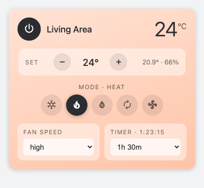
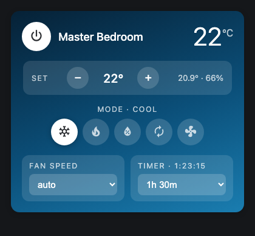
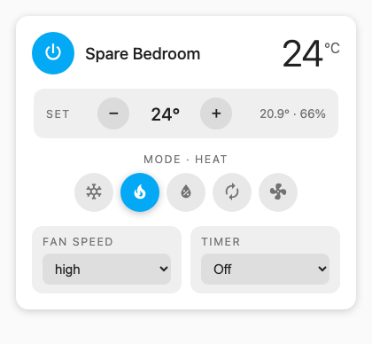

# Sensibo Thermostat Card

A thermostat-style Lovelace card for [Sensibo](https://www.home-assistant.io/integrations/sensibo/) AC controllers with a dedicated power button, mode and fan control, mode-tinted backgrounds in three selectable styles, first-class support for Sensibo's native off-timer — set it, watch it count down, and let the device switch itself off — and a built-in **Climate Assist** selector (Off / React / Dry) that runs a local, subscription-free re-creation of Sensibo's Climate React.

<p align="center">
  
  
  
</p>
<p align="center"><sub>Pastel · Bold · Default (follows your theme)</sub></p>

The built-in thermostat card can't show Sensibo's timer, gives no at-a-glance indication of the running mode, and turning it "on" means hunting through mode buttons. This card fixes all three.

## Features

### Power, mode and fan — console style

- **Dedicated power button.** On/off lives on its own button, separate from mode selection — one obvious tap, styled after a real AC controller. The button fills when running.
- **Stage settings while off.** Tap a mode or pick a fan speed any time. While the unit is off the selections are simply staged (and highlighted); hitting power applies them. While running, changes apply immediately.
- **Mode buttons.** A round-button row for every HVAC mode the device reports — cool, heat, dry, fan-only, and heat/cool (labelled **Auto**). The section label always shows the current selection.
- **Fan speed dropdown.** Built from the device's actual `fan_modes` (quiet, low, medium, medium-high, high, auto, strong — whatever your unit supports).
- **Target temperature** with +/− controls that respect the device's min/max and step, plus live current temperature and humidity readouts.
- **Room sensor override (optional).** Point the current temperature and/or humidity readout at a better-placed sensor entity with `temp_sensor` / `humidity_sensor`; leave them unset and the card reads the Sensibo's own `current_temperature` / `current_humidity` as always. If a chosen sensor goes unavailable the card falls back to the Sensibo value.

### The off-timer

- **Timer dropdown appears when the unit is running**, sitting beside the fan dropdown. Intervals and maximum are configurable (default: 10-minute steps up to 4 hours).
- **Arms automatically at power-on** at a configurable start value (set it to 0 to disable auto-arming), using Sensibo's native `enable_timer` — the schedule lives on Sensibo's cloud, so the AC turns itself off even if Home Assistant is down at the time.
- **Live countdown** in the timer label while running.
- **Change it mid-run** — picking a new duration re-arms the timer; picking Off cancels it without stopping the AC.
- **Powering off manually resets the timer.** No orphaned schedules.

### Climate Assist — a local Climate React

Sensibo's own Climate React (keep the room inside a temperature band by cycling the AC) is now a paid subscription. Climate Assist re-creates it **locally in Home Assistant**, for free, with a set of automations you build once — the card just gives you the selector and the thresholds. Everything lives in HA, so there's no dependency on Sensibo's cloud or app.

Since v1.9.0 Climate Assist has **three positions — Off / React / Dry** — when it's bound to an `input_select`:

| Position | Room drops below the low threshold | Room rises above the high threshold |
| --- | --- | --- |
| **Off** | nothing | nothing |
| **React** | AC switched **off** | AC powered **on in cool** (single-beep `sensibo.full_state`) |
| **Dry** | AC switched to **dry** — the unit stays on | AC switched back to **cool** (powered on in cool if it's off) |

React is the classic Climate React behaviour: the compressor cycles on and off around the band. Dry is for humid climates — instead of switching off when the room is cool enough, the unit drops into dry mode and keeps pulling moisture out of the air, then goes back to cooling when the room warms up again.

> **Heat direction:** Dry only makes sense when cooling. If the room's Assist direction is heat (Assist was switched on while the AC was heating), Dry behaves exactly like React.

- **Off / React / Dry segmented control**, shown beside the controls whenever the unit is on. It writes the selected position with `input_select.select_option`. The **Dry** segment only appears when the select has a `dry` option *and* the AC reports `dry` in its `hvac_modes`.
- **Low / high thresholds** appear while Assist is in React or Dry and adjust in 0.5° steps straight from the card, writing to the threshold entities so the automation reads the same numbers.
- **Logical on-state.** While Assist is in React or Dry the card presents the AC as **on** — power button lit, mode colour held — even when the engine has cycled the physical compressor off between threshold crossings. A subtle indicator shows what the hardware is actually doing: **React · cooling** / **React · idle**, or **Dry · cooling** / **Dry · holding** (holding = the unit is in dry mode).
- **Power-off does the right thing.** Tapping power sets Assist to Off *first* (so the engine can't immediately switch the unit back on) and then turns the AC off — one beep, no fight.
- **Backward compatible.** Point `react_switch` at an `input_boolean` or `switch` instead and you get the original on/off toggle (Off / React only), driven by `homeassistant.turn_on/off`, with the original **Assist · cooling / idle** indicator.

The card supplies the controls; the cycling logic lives in HA automations (one per AC) that you set up separately — see [Climate Assist setup](#climate-assist-setup) below. If you don't wire an Assist entity, the control simply doesn't appear and the card behaves exactly as it always has.

### Looks

- **Three styles, selectable in the GUI editor** (same convention as [airtouch-card](https://github.com/mycrouch/airtouch-card)):
  - `default` — no gradient; the card follows your installed HA theme.
  - `bold` — deep mode-tinted gradients with white text.
  - `pastel` — soft mode-tinted gradients with dark text.
- **Mode-tinted background** — heat, cool, dry, fan-only and auto each get their own colour, with a smooth cross-fade on change. Individual mode colours can be overridden in YAML.
- **Off keeps the last mode's colour** — like the AirTouch console, only the power button reflects the off state, so the card never flashes grey.

### Engineering niceties

- **Minimal IR commands = minimal beeps.** Power-on is sent via `sensibo.full_state` — one API call carrying the complete AC state, so the AC beeps once, not twice (`climate.set_hvac_mode` from off makes two API calls in the Sensibo integration). Mode or fan selections that match what the device is already doing send nothing at all, and the timer never sends IR.
- **No scroll-jump, no flicker.** The DOM is built once and updated in place, and a short optimistic hold after a power press smooths over the Sensibo cloud's state-bounce (on → stale off → on).
- **Zero-config entity wiring.** The timer switch and end-time sensor are derived automatically from the climate entity ID. Overrides available for exotic setups.
- **Full GUI configuration** — appears in the card picker with a visual editor for entity, name, style, and all timer settings.

## Requirements

The official [Sensibo integration](https://www.home-assistant.io/integrations/sensibo/), which provides the `climate.*` entity plus the `switch.*_timer` and `sensor.*_timer_end_time` entities this card uses.

## Installation

### HACS (recommended)

1. HACS → menu (⋮) → **Custom repositories** → add `https://github.com/mycrouch/sensibo-thermostat-card`, category **Dashboard**
2. Download **Sensibo Thermostat Card** (the Lovelace resource is registered automatically)
3. Hard-refresh your browser

### Manual

1. Copy `sensibo-thermostat-card.js` to `/config/www/`
2. Add a dashboard resource: URL `/local/sensibo-thermostat-card.js`, type **JavaScript module**

## Configuration

Everything is configurable in the GUI editor (**Add card → Sensibo Thermostat Card**). YAML equivalent:

```yaml
type: custom:sensibo-thermostat-card
entity: climate.dining_room_sensibo_living_area
name: Living Area          # optional, defaults to the entity's friendly name
temp_sensor: sensor.living_room_temperature      # optional, room temp source (defaults to Sensibo)
humidity_sensor: sensor.living_room_humidity     # optional, room humidity source (defaults to Sensibo)
style: pastel              # optional: default | bold | pastel
default_minutes: 60        # optional, timer armed at power-on (0 = none)
interval_minutes: 10       # optional, timer dropdown steps
max_minutes: 240           # optional, timer dropdown maximum
# Climate Assist (all optional; derived from the entity slug by default)
react_switch: input_select.climate_assist_living_area   # options: off, react, dry
react_low: input_number.climate_assist_living_area_low
react_high: input_number.climate_assist_living_area_high
```

| Option | Default | Description |
| --- | --- | --- |
| `entity` | required | Sensibo `climate` entity |
| `name` | friendly name | Card title |
| `temp_sensor` | Sensibo attr | Optional `sensor` entity for the displayed **current temperature**; unset = the Sensibo `current_temperature`. Falls back to the Sensibo value if unavailable |
| `humidity_sensor` | Sensibo attr | Optional `sensor` entity for the displayed **current humidity**; unset = the Sensibo `current_humidity`. Falls back to the Sensibo value if unavailable |
| `style` | `pastel` | `default` (follows theme), `bold`, or `pastel` (`light` accepted as an alias) |
| `default_minutes` | `60` | Timer value armed at power-on, in minutes; `0` = no timer |
| `interval_minutes` | `10` | Timer dropdown interval |
| `max_minutes` | `240` | Timer dropdown maximum |
| `timer_options` | generated | Explicit list of minute values (overrides interval/max) |
| `timer_switch` | derived | Override the `switch.*_timer` entity |
| `timer_end` | derived | Override the `sensor.*_timer_end_time` entity |
| `react_switch` | `switch.*_climate_react` | Climate Assist entity. An `input_select` with options `off` / `react` / `dry` gives the three-position control (recommended); an `input_boolean` or `switch` gives the original on/off toggle. The derived native react switch is only the default for generic setups |
| `react_low` | `number.*_climate_react_low_temperature_threshold` | Low-threshold entity; point at an `input_number` when using local helpers |
| `react_high` | `number.*_climate_react_high_temperature_threshold` | High-threshold entity; point at an `input_number` when using local helpers |
| `colors` | built-in | Per-mode CSS background overrides, e.g. `heat: "linear-gradient(145deg,#fdd,#fba)"` |

The threshold steppers appear only when `react_low` / `react_high` resolve to a **writable** entity (`number` or `input_number`). If they point at a read-only `sensor` (or aren't set), the Assist control still works but the numbers are hidden.

### Timer behaviour in detail

The timer dropdown is hidden while the unit is off. Powering on from the card arms Sensibo's native off-timer at `default_minutes` and the label becomes a live countdown. Changing the dropdown mid-run re-arms at the new duration; selecting Off cancels the timer while the AC keeps running; powering off manually cancels and resets it. Because the schedule runs on Sensibo's cloud rather than in Home Assistant, the shutdown fires even if HA is restarting.

Powering on from the Sensibo app or an IR remote does not arm the timer — if you want that, pair the card with a small automation that calls `sensibo.enable_timer` when the climate entity leaves `off`.

## Climate Assist setup

The card renders the Climate Assist controls, but the actual thermostat cycling is done by Home Assistant automations you create once per AC. The card only needs three things to exist:

1. **An Assist entity** — create an `input_select` per AC with the options `off`, `react`, `dry` (recommended), so the whole feature lives in Home Assistant, independent of Sensibo's cloud and app. The card writes it with `input_select.select_option`. An `input_boolean` (or a native `switch.*_climate_react`) still works and gives the two-position toggle; if you use the native switch, keep it **off** on the Sensibo side so the app never fights the HA engine. (`react_switch`.)
2. **Two writable thresholds** — Sensibo exposes the Climate React thresholds as **read-only** `sensor.*_climate_react_*_temperature_threshold` entities, so create an `input_number` per AC for the low and high setpoints (0.5° step) and point `react_low` / `react_high` at them.
3. **A direction memory** (optional but recommended) — an `input_select` per AC with `cool` / `heat`, captured from the AC's mode at the moment Assist leaves Off (heat → heat, anything else → cool). It tells the engine which way the band works.
4. **An engine automation** per AC that, while the Assist select is not `off`, watches the Sensibo climate entity's `current_temperature` (5-minute `for:` dwell on both threshold triggers for compressor protection, `mode: single`, `max_exceeded: silent`) and acts per the position table above:
   - **React (cool):** above high → power **on in cool** with a single `sensibo.full_state` call (one IR blast, one beep); below low → **off** with `climate.set_hvac_mode: off`. Heating is the mirror image.
   - **Dry (cool direction):** below low → `climate.set_hvac_mode: dry` (or `sensibo.full_state` with `mode: dry` if the unit is off); above high → `climate.set_hvac_mode: cool` (or `full_state` cool if off). In heat direction, fall through to the React branches.
   - Skip redundant commands — don't send dry if the unit is already in dry, cool if already cooling, off if already off. Every IR command beeps.
   - Also trigger on the select changing (leaving `off`, or switching between React and Dry) so the engine re-evaluates immediately.

Pair it with a small companion automation so that if the AC is switched **off** by anything *other* than the engine (the Sensibo off-timer, a manual/app power-off), the Assist select is set back to `off` too — trigger only on the climate entity changing **to `off`** (so the engine's dry ↔ cool switches never trip it), and distinguish the engine's own power-off via the state-change context (`trigger.to_state.context.parent_id is none` = external) so normal React cycling isn't interrupted.

> **Keep the card and the engine on the same sensor.** If you set `temp_sensor` (or `humidity_sensor`) to override the room source on a card, re-point that room's engine automation to trigger on the same sensor — a `numeric_state` trigger on the sensor entity rather than on the climate entity's `current_temperature` attribute. Otherwise the card displays one temperature while the engine cycles the AC on another.

> **If you later subscribe to Sensibo Climate React**, keep the native `switch.*_climate_react` **off** and don't bind the card to it — otherwise the Sensibo engine and the HA engine will act on the same AC and fight each other. With an `input_select` (or `input_boolean`) Assist entity the two are fully decoupled.

## The mycrouch card collection

These Home Assistant Lovelace cards share a common design language — a clean **default** look that inherits your active theme, plus a per-card **theme** picker — so they sit together neatly on one dashboard. Pair any of them with **gradient-themes** for 40 ready-made gradient and pastel backgrounds.

| Project | What it is |
| --- | --- |
| [origami-entity-card](https://github.com/mycrouch/origami-entity-card) | Group any device's entities as a row list or chip grid |
| [pro-v-weather-card](https://github.com/mycrouch/pro-v-weather-card) | Weather-station console — clock, moon, forecast, UV, solar, wind |
| [weather-station-card](https://github.com/mycrouch/weather-station-card) | LCD-console weather station with backlight themes |
| [airtouch-card](https://github.com/mycrouch/airtouch-card) | AirTouch 4/5 AC + zone control |
| **sensibo-thermostat-card** (this card) | Sensibo thermostat with mode-coloured backgrounds |
| [ecovacs-vacuum-card](https://github.com/mycrouch/ecovacs-vacuum-card) | Ecovacs/Deebot vacuum with area cleaning |
| [gradient-themes](https://github.com/mycrouch/gradient-themes) | 40 gradient + pastel dashboard themes |

## License

MIT
